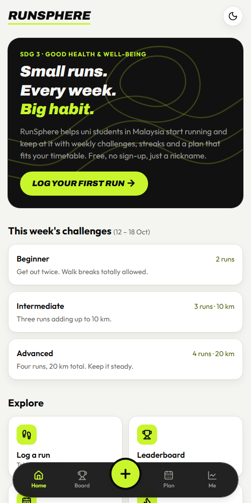
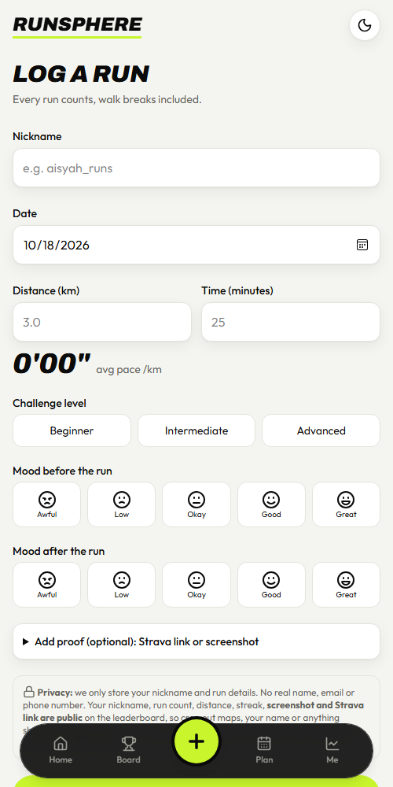
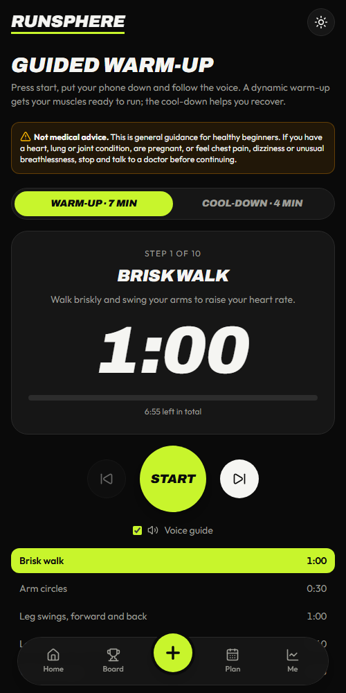
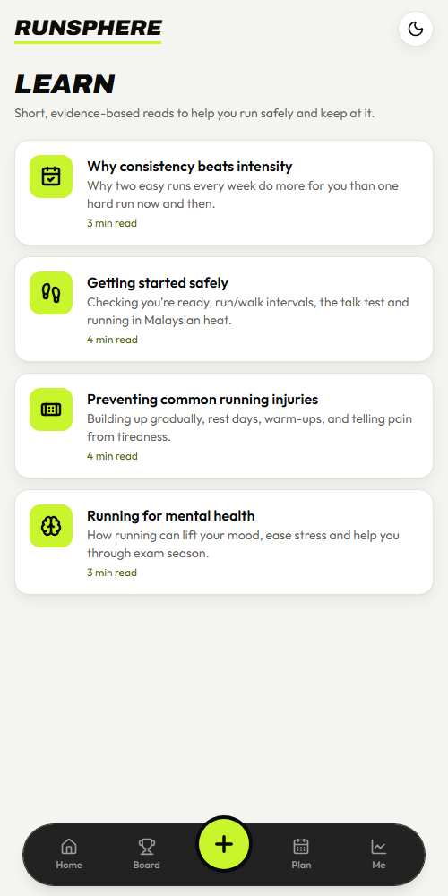

<div align="center">

# RunSphere

**Small runs. Every week. Big habit.**

A free, mobile-first web app that helps beginner university runners in Malaysia build a consistent running habit.
Built for **UN SDG 3: Good Health and Well-being**.

**[runsphere.vercel.app](https://runsphere.vercel.app/)** · No sign-up · No download · Just a nickname


</div>

<p align="center">
  
  
  
  
</p>

## Features

- **Log a run:** distance, time, level and mood, with an optional Strava screenshot or link. Pace is calculated automatically.
- **Leaderboard:** ranked by **consistency** (runs this week, then streak), not speed or distance.
- **Weekly challenges and streaks:** e.g. Beginner = 2 runs a week. A streak is consecutive weeks with 2+ runs.
- **Personalised plan:** adapts to your last 4 weeks of runs, with safety rules (run/walk for beginners, rest days, increases of no more than ~10% a week).
- **Guided warm-up:** step timer with voice cues.
- **My progress:** stats, mood change, weekly chart, habit heatmap, awards and local distance fun facts.
- **Learn:** short, referenced articles on running safely and staying consistent.
- **Light and dark themes**

## Tech stack

Next.js 16 (TypeScript) · Tailwind CSS 4 · Supabase (Postgres + Storage) · Vercel. Free tiers only.

The browser never talks to the database directly: all reads and writes go through Next.js API routes, and Row Level Security blocks everything else.

## Getting started

1. Create a free [Supabase](https://supabase.com) project and run [`supabase/schema.sql`](supabase/schema.sql) in the SQL Editor. Optionally run [`supabase/seed.sql`](supabase/seed.sql) for demo data.
2. Copy `.env.example` to `.env.local` and add your Supabase **Project URL** and **service role key**. Never commit this file.
3. Run:
   ```bash
   npm install
   npm run dev     # http://localhost:3000
   npm test        # unit tests
   ```

**Deploy:** import the repo into [Vercel](https://vercel.com), add the same two environment variables, and deploy. Every push to `main` redeploys automatically. Check `/api/health` returns `"ok": true`.

## Project structure

```
app/          pages and API routes (api/ is the only code that touches the database)
components/   shared UI
lib/          core logic: weeks, validation, streaks/ranking (stats.ts), plan rules (plan.ts)
data/         editable content: challenges, milestones, awards, warm-up, articles
supabase/     schema.sql, seed.sql
tests/        unit tests
```

Content such as challenge targets, articles and awards lives in plain files in [`data/`](data/). Edit and push, no other code changes needed.

## Privacy

Only a nickname and run details are stored (Malaysia PDPA 2010). Leaderboard entries, screenshots and Strava links are public, and users are told this before uploading. RunSphere gives general guidance, not medical advice.
